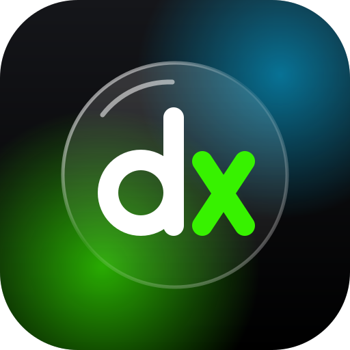

  

<h1 align="center">dxify</h1>

  <b>Spotify for iOS, in Liquid Glass. No jailbreak.</b> 
  Built on <a href="https://github.com/skopevoj/spoti.pw"><b>spoti.pw</b></a> by <a href="https://github.com/skopevoj">Vojtěch Škopek</a>.

  
  
  
  
  

  <a href="#build-it">Build it</a> ·
  <a href="#whats-new-in-dxify">What's new</a> ·
  <a href="#credits">Credits</a> ·
  <a href="docs/tweaks.md">Hack on it</a> ·
  <a href="https://ko-fi.com/darkksh">Support spoti.pw</a>

  
  
  
  
  
  
   Screenshots from spoti.pw, whose look dxify keeps.

> [!IMPORTANT]
> **dxify stands on spoti.pw.** Vojtěch Škopek designed and built almost everything you see here: the
> Liquid Glass redesign, the Apple Music style lyrics, the Live Activity, the audio effects, the
> haptics, the settings, the build pipeline. dxify is a fork of
> [spoti.pw 0.21.1](https://github.com/skopevoj/spoti.pw/releases/tag/v0.21.1), its last release under
> GPL-3.0, with [the changes below](#whats-new-in-dxify). It is an independent fork that spoti.pw's author
> neither makes, maintains nor endorses, so please report dxify's bugs [here](https://github.com/dx1ctrl/dxify/issues),
> not to spoti.pw. If you enjoy it, [buy Vojtěch a coffee](https://ko-fi.com/darkksh): it's their work.

## What it is

A Theos tweak that rebuilds Spotify for iOS in Liquid Glass. You inject it into your own decrypted
IPA and sign it with your own certificate. Settings → **Mod Settings** picks one of two looks:

- **Redesigned** (iOS 26+): a clean-sheet Liquid Glass Spotify. Glass tab bar, search field and now
  playing bar, a redesigned player and lyrics page with Apple Music style lyrics, a decluttered Home,
  Search's categories on tinted glass, a Library with one large title, and playlist, album and artist
  pages laid out the way the Music app does them. Black throughout, with its own accent colour.
- **Native** (iOS 16.1+): Spotify's own screens with tweaks on top: hide switches, glass header
  buttons, a Home gradient, AMOLED black and an accent colour.

Under either look you also get lyrics from the sources you pick, lyrics on the lock screen, a Live
Activity, JamesDSP audio effects, vibrations that play along with the music, speed and pitch, double-tap
gestures on the player, blocked artists, SponsorBlock for podcasts, telemetry blocking, share links
without tracking tags, and every one of Spotify's remote-config flags.

| | |
|---|---|
| Spotify | **9.1.78**. Use exactly this version's IPA: the mod hooks Spotify's own classes, which change between releases |
| The redesign | **iOS 26+**, since Liquid Glass is drawn by the system from 26 on |
| Native look | iOS 16.1+ |
| Live Activity | iOS 17+ |

## What's new in dxify

Compared with spoti.pw 0.21.1:

- **Your Spotify login stays on your phone.** The Spicy Lyrics source, when switched on, sent your
  Spotify access token to a third-party server, and anyone holding that token can act on your account.
  It's gone, and every lyrics source now gets only the track.
- **No install counting.** To count installs, spoti.pw 0.21.1 sent its server an install ID, your device
  model, iOS and app versions, language, region and which switches were on, once a day. Nothing of your
  account, but there was no switch to turn it off. dxify's update check only reads its own public
  GitHub releases.
- **The update notice shows once per release**, not on every launch. A leftover debug line brought it
  back each time.
- **No Premium spoofing, no ad or upsell hacks.** dxify is a look-and-feel mod. Spoof Premium, Hide ads
  and Hide upsells rewrote your account's state and Spotify's traffic, which risks the account, so
  they're removed. Telemetry blocking, the Search clutter switches and the tips moved to a new
  **Privacy** page.
- **From [EeveeSpotify Reincarnated](https://github.com/SideloadLabs/EeveeSpotifyReincarnated)**, rewritten
  in Objective-C: **SponsorBlock** skips sponsor reads and self-promotion in podcast episodes and marks
  them on the scrubber (Player → SponsorBlock), **Clean share links** takes the `si=` that names your
  account off the links you share, **Block rating prompts** stops the App Store prompt (both on the
  Privacy page), **Genius** and **PetitLyrics** join the lyrics sources, and a CarPlay crash on
  re-signed builds is fixed. Its Premium, ad, upsell and session patches are left out, as above.
- **Every push is compiled in CI**, so a change that doesn't build never reaches a release.
- **Credit where it's due.** The app's Mod page and its coffee button now point to spoti.pw and its
  creator.

## Build it

No IPA is distributed. Bring a decrypted **Spotify 9.1.78** IPA and you get an unsigned
`dxify-<version>.ipa` to sign with SideStore, Feather or any certificate signer. Each
[release](https://github.com/dx1ctrl/dxify/releases) also carries the tweak's `.deb`.

### Build with GitHub Actions

Fork this repo, enable Actions, and run **Build IPA from your own Spotify IPA**. It takes a direct link
to your decrypted `.ipa` and hands the built IPA back as a workflow artifact. No Mac needed. The link is
masked in the log and the result stays in your fork.

### Build on a Mac

You need Theos in `~/theos` and Xcode with an iPhoneOS 26+ SDK (`xcode-select` it). An SDK in
`~/theos/sdks` alone builds too, but without the Live Activity. Then:

    brew install make ldid dpkg zsign ideviceinstaller libimobiledevice
    uv tool install "cyan @ git+https://github.com/asdfzxcvbn/pyzule-rw"

Put the decrypted `.ipa` in `ipa/`, then:

    make release    # out/dxify-<version>.ipa, ready to sign
    make install    # the same, signed with your certificate and pushed over USB

`make install` reads `SIGN_P12`, `SIGN_PROFILE` and `SIGN_P12_PASSWORD` from `.signing.env`. Copy
`.signing.env.example` and fill it in.

The first build spends a minute reading Spotify's flags out of your IPA. `make flags` regenerates them.

### Signing

Sign with a bundle id that matches your certificate's App ID. If it doesn't match, the app still works
but tapping the player on the lock screen won't open it, and the app tells you on first launch which
id to use. In Feather, copy the App ID into **Identifier** and leave **PPQ protection** off. AltStore,
SideStore and Sideloadly get this right on their own.

The app keeps Spotify's bundle id, so it installs over the real Spotify.

## Coming from spoti.pw

- **Your settings carry over.** dxify keeps spoti.pw's settings keys, so installing it over a spoti.pw
  build keeps your setup. The switches dxify removed are simply ignored.
- **The `.deb` replaces spoti.pw's** (`com.spotipw`) instead of installing beside it.
- **Newer spoti.pw features aren't here.** spoti.pw 0.22.0 and later are source-available under a
  license that doesn't allow modified versions, so dxify is built only on 0.21.1 and takes nothing from
  later releases.

## Support

dxify doesn't ask for money of its own. The coffee button in the app and the Sponsor button on this
repo both go to Vojtěch Škopek, who built spoti.pw.

## Contributing

Pull requests are welcome. Read [`docs/tweaks.md`](docs/tweaks.md) and [`AGENTS.md`](AGENTS.md) first:
the two looks never mix, and imports run one way between layers. Commit as `feat:` or `fix:` so
Release Please writes the changelog, and keep CI green.

## Credits

### spoti.pw, the foundation

dxify exists because of **[spoti.pw](https://github.com/skopevoj/spoti.pw)** by
**[Vojtěch Škopek](https://github.com/skopevoj)** and everyone who contributed to it. The Liquid Glass
redesign, the native look's tweaks, the lyrics engine and its sources, the lock screen lyrics, the Live
Activity, the JamesDSP integration, music haptics, speed and pitch, gestures, artist blocking, the
settings framework, the welcome tour, the build pipeline, the test harnesses and the developer guide
are all spoti.pw's. dxify's own changes are the ones listed in
[What's new in dxify](#whats-new-in-dxify). Everything else is spoti.pw, kept as it was written, and
its history is in [CHANGELOG.md](CHANGELOG.md).

[Site](https://spoti.pw) · [Code](https://github.com/skopevoj/spoti.pw) · [Support on Ko-fi](https://ko-fi.com/darkksh)

### Built with and on

| Project | By | What dxify uses it for |
|---|---|---|
| [EeveeSpotify](https://github.com/whoeevee/EeveeSpotify) and [EeveeSpotify Reincarnated](https://github.com/SideloadLabs/EeveeSpotifyReincarnated) | whoeevee, SideloadLabs and their contributors | The way the lyrics hook answers Spotify's lyrics requests; SponsorBlock, clean share links, the rating prompt block, the CarPlay crash fix and the Genius and PetitLyrics sources, ported from Reincarnated 7.0.0 (GPL-3.0) |
| [SponsorBlock](https://sponsor.ajay.app) and [Spot-SponsorBlock](https://github.com/Spot-SponsorBlock/Spot-SponsorBlock-Extension) | Ajay Ramachandran and the SponsorBlock community | The podcast segments that are skipped, and the way Spotify's episodes are keyed in SponsorBlock's database |
| [JamesDSP](https://github.com/james34602/JamesDSPManager) | James Fung | The audio effects engine, libjamesdsp (GPLv2, in `vendor/libjamesdsp`) |
| [JDSP4Linux](https://github.com/Audio4Linux/JDSP4Linux) | Audio4Linux | libjamesdsp as it is packaged here |
| [RootlessJamesDSP](https://github.com/timschneeb/RootlessJamesDSP) | Tim Schneeberger | The bundled Liveprog scripts and DDC presets |
| [Theos](https://theos.dev) | The Theos team | Building the tweak |
| [cyan](https://github.com/asdfzxcvbn/pyzule-rw) | asdfzxcvbn | Injecting it into the IPA |
| [FLEX](https://github.com/FLEXTool/FLEX), as AutoFLEX | FLEXTool, hopeless | The inspector the view trees are read through (debug builds only) |

### Lyrics

Lyrics come only from the services you switch on: [LRCLIB](https://lrclib.net),
[Musixmatch](https://www.musixmatch.com), [NetEase Cloud Music](https://music.163.com),
BiniLyrics, Unison (Better Lyrics' hand-timed lyrics), [Genius](https://genius.com) and
[PetitLyrics](https://petitlyrics.com). Each is sent only the track. Thank you to the people who run them.

### Design and tools

The redesign follows Apple's Liquid Glass, the Music app's layouts and Apple's Human Interface
Guidelines.

## License

dxify is free software under the [GNU General Public License v3.0](LICENSE). It is a modified version of
spoti.pw 0.21.1 by Vojtěch Škopek, which was released under the same license. dxify's changes, made by
dx1ctrl from 11 October 2026 on, are listed above and in the git history. Files in `vendor/` keep
their own licenses.

Not affiliated with Spotify, and not with spoti.pw beyond being built on it.
